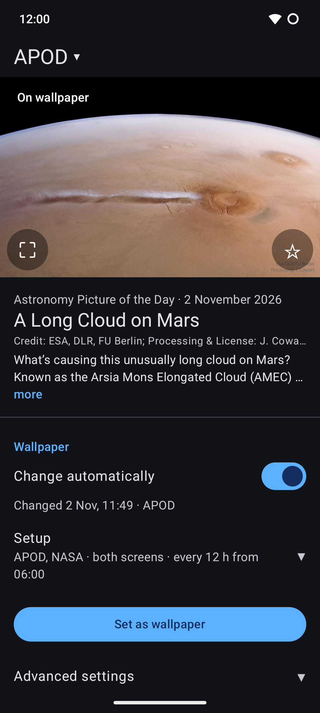

# APODroid

An Android app that sets NASA's [Astronomy Picture of the Day](https://science.nasa.gov/apod/)
(APOD) as your wallpaper, once a day, on its own. NASA's Image of the Day and the Earth
Observatory's Image of the Day can be added ("More NASA pictures").



## What it does

One page: today's picture with its title and date, and the settings below it (beside it on
tablets and in landscape). With "More NASA pictures" on, swipe or use the name above the picture
to see each source; "On wallpaper" marks the picture that's on your wallpaper.

- **Change wallpaper automatically:** alarms check for the new picture at the change times,
  only with a network, and set it once it's out (APOD at about 00:05 US Eastern time). On or off
  at once.
- **Setup**, a draft until you tap **Set as wallpaper**:
  - **Where:** home screen, lock screen, or both. With **More NASA pictures** on, **Pictures
    from** instead: APOD, NASA (Image of the Day), Earth (Observatory), each on the home screen,
    the lock screen or both. A screen with two or more takes turns, every 24, 12, 6 or 3 hours,
    and shows only pictures it hasn't shown yet. NASA and Earth Observatory post on weekdays only.
  - **New picture at:** the hour the wallpaper changes (06:00 by default). A picture that comes
    out in the 3 hours after it still goes on.
  - **If APOD is a video:** skip it, use NASA's or Earth Observatory's picture, or a picture of
    your own. The page shows a ▶ tile that opens the video on NASA's website.
- **Advanced settings:** save every new picture to your gallery, up to a size you choose.
- Pull down to refresh. Notes below the picture say when the check fails.
- If Android would pause the app because you don't open it, a note below the picture names the
  settings in App info that prevent it.
- Tap the picture to open it on NASA's website; tap the star to save the original to your
  gallery (`Pictures/APODroid/`).
- Tap ⛶ to choose which part of the picture becomes the wallpaper, or the whole picture on a
  blurred or black background; ✓ keeps it, Set as wallpaper sets it.
- The explanation's first two lines show under the title; tap them to read it all.
  Long-press the title or the explanation to copy the link or the text.

## Install

Get it on [F-Droid](https://f-droid.org/packages/io.github.buerlino.apodroid/), download the APK
from [Releases](https://github.com/buerlino/APODroid/releases), or add
`https://github.com/buerlino/APODroid` to [Obtainium](https://github.com/ImranR98/Obtainium) to
get updates. Android 10 or newer.

On an iPhone? [APODiOS](ios/README.md) is a shortcut that does the plain part: today's APOD on
both screens, every morning.

## Where the pictures come from

The official APOD API (`api.nasa.gov/planetary/apod`) currently returns the NASA logo instead of
the picture: APOD moved to science.nasa.gov and the API wasn't updated. APODroid reads the
newest APOD post from science.nasa.gov's public WordPress API instead. NASA Image of the Day
comes from its RSS feed on www.nasa.gov, Earth Observatory's from the same WordPress API as APOD.
None of this is a documented API and it may change; if it does, the app leaves your wallpaper
alone.

## Privacy

No account, no ads, no tracking. The app talks only to NASA's websites (nasa.gov). Permissions:
`INTERNET`, `SET_WALLPAPER`, and `ACCESS_NETWORK_STATE` and `RECEIVE_BOOT_COMPLETED` for the
daily job.

## Build

Native Android, Kotlin + Jetpack Compose. Needs the Android SDK; Gradle runs on JDK 21.

```
./gradlew :core:test :app:assembleRelease
```

## License

GPLv3, see [LICENSE](LICENSE). APODroid is not made by or affiliated with NASA.
