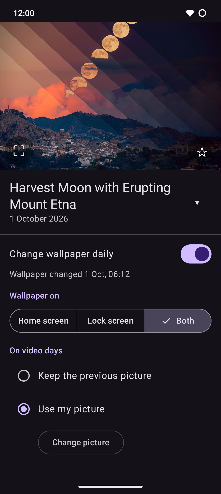

# APODroid

An Android app that sets NASA's [Astronomy Picture of the Day](https://science.nasa.gov/apod/)
(APOD) as your wallpaper, once a day, on its own. NASA's Image of the Day and the Earth
Observatory's Image of the Day can be added.



## What it does

One page: today's picture with its title and date, and the settings below it (beside it on
tablets and in landscape). With more than one source, a tab per source sits above the picture,
and "On wallpaper" marks the picture that's on your wallpaper.

- **Change wallpaper automatically:** a background job checks for the new picture every few hours, only
  with a network, and sets it once it's out (about 00:05 US Eastern time).
- **Pictures from:** pick APOD, NASA (Image of the Day), Earth (Observatory). With two or more they
  take turns: change every day, 12, 6 or 3 hours. NASA and Earth Observatory post on weekdays
  only.
- **Where:** home screen, lock screen, or both.
- **If APOD is a video:** keep the previous wallpaper, use NASA's or Earth Observatory's picture,
  or a picture of your own (with APOD alone; with more, the next source takes its turn). The page shows a ▶ tile that
  opens the video on NASA's website.
- **Set as wallpaper now:** sets the picture shown; with two or more sources, its turn starts.
- Pull down to refresh. Notes below the picture say when the check fails.
- If Android would pause the app because you don't open it, a note below the picture names the
  settings in App info that prevent it.
- Tap the picture to open it on NASA's website; tap the star to save the original to your
  gallery (`Pictures/APODroid/`).
- Tap ⛶ to choose which part of the picture becomes the wallpaper; ✓ sets it.
- The explanation's first two lines show under the title; tap them to read it all.
  Long-press the title or the explanation to copy the link or the text.

## Install

Get it on [F-Droid](https://f-droid.org/packages/io.github.buerlino.apodroid/), download the APK
from [Releases](https://github.com/buerlino/APODroid/releases), or add
`https://github.com/buerlino/APODroid` to [Obtainium](https://github.com/ImranR98/Obtainium) to
get updates. Android 10 or newer.

## Where the pictures come from

The official APOD API (`api.nasa.gov/planetary/apod`) currently returns the NASA logo instead of
the picture: APOD moved to science.nasa.gov and the API wasn't updated. APODroid reads the
newest APOD post from science.nasa.gov's public WordPress API instead. NASA Image of the Day
comes from its RSS feed on www.nasa.gov, Earth Observatory's from the same WordPress API as APOD.
None of this is a documented API and it may change; if it does, the app leaves your wallpaper
alone.

## Privacy

No account, no ads, no tracking. The app talks only to NASA's websites (nasa.gov). Permissions:
`INTERNET`, `SET_WALLPAPER`, and `ACCESS_NETWORK_STATE` and `RECEIVE_BOOT_COMPLETED` for the
daily job.

## Build

Native Android, Kotlin + Jetpack Compose. Needs the Android SDK; Gradle runs on JDK 21.

```
./gradlew :core:test :app:assembleRelease
```

## License

GPLv3, see [LICENSE](LICENSE). APODroid is not made by or affiliated with NASA.
