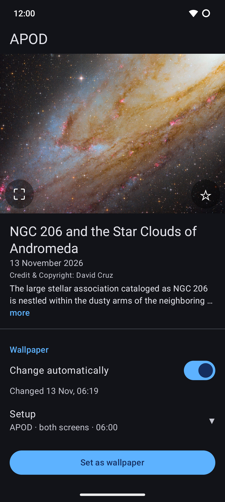

# APODroid

An Android app that sets NASA's [Astronomy Picture of the Day](https://science.nasa.gov/apod/)
(APOD) as your wallpaper, once a day, on its own. NASA's Image of the Day and the Earth
Observatory's Image of the Day can be added ("More NASA pictures").



## What it does

One page: today's picture with its title and date, and the settings below it (beside it on
tablets and in landscape). With "More NASA pictures" on, swipe or use the name above the picture
to see each source; a chip on the picture marks the one that's on your wallpaper.

- **Change automatically:** alarms check for the new picture at the change times and set it once
  it's out (APOD at about 00:05 US Eastern time). On or off at once.
- **Setup**, a draft until you tap **Set as wallpaper**:
  - **Where:** home screen, lock screen, or both. With **More NASA pictures** on, **Pictures
    from** instead: APOD, NASA (Image of the Day), Earth (Observatory), each on the home screen,
    the lock screen or both. Drag the sources into order. A screen with two or more takes turns in
    that order, every 24, 12, 6 or 3 hours. NASA and Earth Observatory post on weekdays only.
  - **Size:** Centre, Auto (the frame on the picture's subject; a wide APOD goes on sideways
    unless NASA's text says it has an up) or Live: a wide picture moves across the home screen
    over the day (a live wallpaper, picked once in Android's picker).
  - **New picture at:** the hour the wallpaper changes (06:00 by default). A picture that comes
    out in the 3 hours after it still goes on; turn on **As soon as it's out** to get each new
    picture within the hour.
  - **If APOD is a video:** skip it, use NASA's or Earth Observatory's picture, or a picture of
    your own. The page shows a ▶ tile (with a still from NASA's own videos) that opens the video
    on NASA's website.
  - **Darken bright pictures** (on by default), so the clock and widgets stay readable.
  - **Keep pictures sharp:** enlarges a small picture at most 2×; the rest of the screen shows it
    blurred.
- **Advanced settings:** save every new picture to your gallery, up to a size you choose;
  **Keep running**, so the phone can't stop the app between changes.
- Pull down to refresh. Notes below the picture say when the check fails, which settings keep
  Android from pausing the app (for your phone's maker), and when the phone stopped the app and a
  change came late.
- Tap the picture to open it on NASA's website; tap the star to save the original to your
  gallery (`Pictures/APODroid/`).
- Tap ⛶ to choose which part of the picture becomes the wallpaper, turn it sideways, or show the
  whole picture on a blurred or black background; ✓ sets it.
- The explanation's first two lines show under the title; tap them to read it all.
  Long-press the title or the explanation to copy the link or the text.

## Install

Get it on [F-Droid](https://f-droid.org/packages/io.github.buerlino.apodroid/), download the APK
from [Releases](https://github.com/buerlino/APODroid/releases), or add
`https://github.com/buerlino/APODroid` to [Obtainium](https://github.com/ImranR98/Obtainium) to
get updates. Android 10 or newer.

On an iPhone? [APODiOS](ios/README.md) is a shortcut that does the plain part: today's APOD on
both screens, every morning.

## Where the pictures come from

The official APOD API (`api.nasa.gov/planetary/apod`) currently returns the NASA logo instead of
the picture: APOD moved to science.nasa.gov and the API wasn't updated. APODroid reads the
newest APOD post from science.nasa.gov's public WordPress API instead. NASA Image of the Day
comes from its RSS feed on www.nasa.gov, Earth Observatory's from the same WordPress API as APOD.
None of this is a documented API and it may change; if it does, the app leaves your wallpaper
alone.

## Privacy

No account, no ads, no tracking. The app talks only to NASA's websites (nasa.gov). Permissions:
`INTERNET`, `SET_WALLPAPER`, `ACCESS_NETWORK_STATE` and `RECEIVE_BOOT_COMPLETED` for the daily
update, and `FOREGROUND_SERVICE` and `FOREGROUND_SERVICE_SPECIAL_USE` for Keep running (off by
default). Saving to the gallery needs no permission.

## Build

Native Android, Kotlin + Jetpack Compose. Needs the Android SDK; Gradle runs on JDK 21.

```
./gradlew :core:test :app:assembleRelease
```

## License

GPLv3, see [LICENSE](LICENSE). APODroid is not made by or affiliated with NASA.
